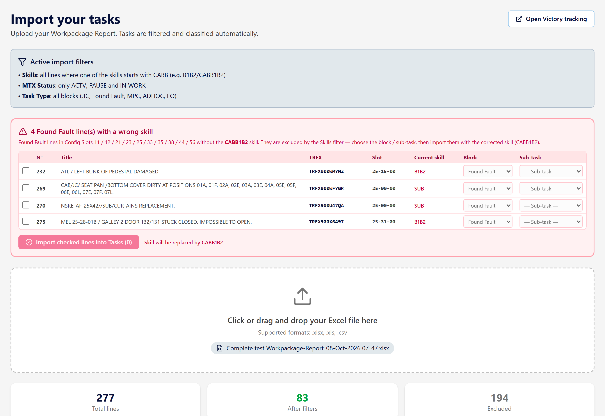
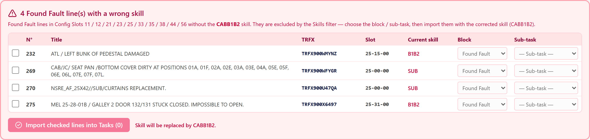
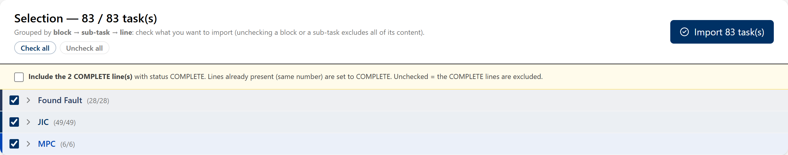
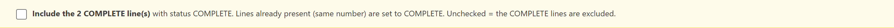

# Import Victory — Présentation et tutoriel

## Présentation

L'**Import Victory** transforme un export **Workpackage Report** (Victory) en tâches
prêtes à l'emploi dans AeroTeam : JIC, Found Fault, MPC, ADHOC, EO.

Il **ajoute** ces tâches à la charge en cours du profil, avec leur TRFX, leur
immatriculation, leur description détaillée et leurs priorités (MEL / EXMP / NSRE / TLI /
IDT). Il ne touche pas aux équipes, consignes ni affectations déjà en place.

Pendant l'analyse, AeroTeam signale automatiquement les points à risque :

- les lignes **sans skill** (à compléter avant import) ;
- les **Found Fault au mauvais skill** (slots 11/12/21/23/25/33/35/38/44/56 sans CABB1B2) ;
- les lignes **COMPLETE**, à inclure ou non selon le besoin.

## Avant de commencer

- Être sur le **réseau de l'entreprise ou en VPN**.
- Télécharger le **Workpackage Report** depuis Victory. Le bouton
  **« Open Victory tracking »** ouvre `www.vic.klm.com` dans un nouvel onglet.

## Utilisation pas à pas

### 1. Charger le fichier

Cliquer dans la zone pointillée (ou glisser-déposer le fichier). Le nom du fichier
s'affiche, avec les compteurs :

- **Total lines** : lignes du fichier ;
- **After filters** : lignes proposées à l'import ;
- **Excluded** : lignes écartées automatiquement.

### 2. Traiter les alertes (si présentes)

**Found Fault au mauvais skill** (encart rouge) : cocher les lignes à intégrer, choisir
le **Bloc** et la **Sous-tâche**, puis cliquer
**« Import checked lines into Tasks »** — le skill est corrigé en **CABB1B2**.

**Lignes sans skill** (encart ambre) : même principe. Saisir le skill (prérempli
`CAB1B2`), choisir le bloc et la sous-tâche (ou en créer une nouvelle), cocher, puis
importer.

> Les cases sont **décochées par défaut** : rien n'est intégré sans validation.

### 3. Vérifier la sélection

Les lignes sont regroupées par **bloc → sous-tâche → ligne**. Cocher/décocher une ligne,
une sous-tâche ou un bloc entier, ou utiliser **Check all / Uncheck all**.

### 4. Lignes COMPLETE (option)

La case **« Include the N COMPLETE line(s) with status COMPLETE »** permet d'intégrer
aussi les lignes déjà terminées du fichier, avec le statut COMPLETE (les lignes déjà
présentes passent à COMPLETE). Décochée = elles restent exclues.

### 5. Importer

Cliquer sur **« Import X task(s) »**. Un bandeau vert confirme l'import.

### 6. Vérifier dans Tasks

Aller dans **Tasks** : les lignes sont classées par bloc et sous-tâche. On peut ouvrir la
description et les étapes (📄), renommer un titre (✏️), mettre une note, changer le
statut, et cliquer sur le TRFX pour ouvrir la ligne dans Maintenix.

## À retenir

- L'import **ajoute** les tâches ; il ne remplace pas la charge existante.
- Un grand nombre de lignes « Excluded » est normal (lignes terminées, skills hors
  périmètre…). Les alertes couvrent les cas à ne pas oublier.
- Pour repartir de zéro : **Export & Backup → Reset all** (membres permanents et
  Bloc-notes conservés).
- La sauvegarde du profil est automatique ; en cas de coupure réseau, l'app réessaie.

## Checklist express

☐ Réseau entreprise / VPN
☐ Bon fichier Victory (bon avion)
☐ Alertes « sans skill » et « mauvais skill » traitées
☐ Sélection vérifiée
☐ Case COMPLETE selon besoin
☐ Import cliqué
☐ Contrôle dans Tasks
